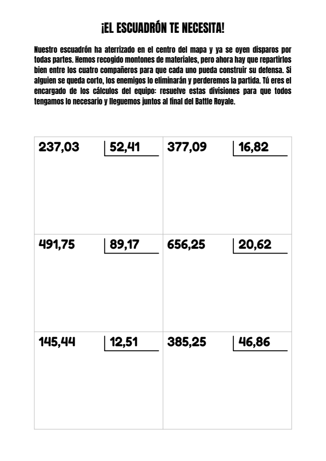

# Divisiones · Fortnite

Genera fichas de ejercicios en PDF para practicar divisiones con decimales:
6 divisiones con temática de Fortnite, pensadas para resolverlas a mano
sobre el propio PDF con el lápiz de una tablet. Cada ficha es distinta, se
puede enviar por correo y también generar desde el navegador con un solo
botón.



- El dividendo tiene siempre tres cifras enteras y dos decimales
  (de 100,01 a 999,99) y el divisor dos cifras enteras y dos decimales
  (de 10,01 a 99,99). La última cifra decimal nunca es 0.
- Las divisiones van en una cuadrícula de 2 columnas x 3 filas, cada una con
  su caja y el resto de la celda libre para hacer la cuenta.
- La cabecera (título y texto) se elige al azar entre 100 historias de
  Fortnite: hay que ayudar a ganar el Battle Royale calculando los
  materiales de las construcciones. No se repite ninguna hasta que han
  salido todas, y nunca sale la misma en dos fichas seguidas (las que ya
  han salido se guardan en `cabeceras_salidas.json`).

## Instalación

Hace falta Python 3.13 y [uv](https://docs.astral.sh/uv/).

```bash
git clone <URL-del-repositorio> divisiones
cd divisiones
uv venv
uv pip install --python .venv/bin/python reportlab
```

Para enviar las fichas por correo, crea el fichero `.env` con los datos SMTP
(usuario, contraseña, remitente y destinatarios):

```bash
cp .env.ejemplo .env      # y rellénalo, o copia el .env de otro ordenador
```

El `.env` contiene la contraseña, así que **no se sube a git**: hay que
copiarlo a mano a cada ordenador.

Los datos del correo se leen **solo** de este fichero (o, en Docker, del
secreto): las variables de entorno no se usan, así que una variable con el
mismo nombre que haya quedado en la terminal no cambia nada. Si al usar
`-e` no se encuentra el fichero o le falta algún dato, el programa avisa y
termina antes de generar la ficha. Sin `-e` no hace falta tener `.env`.

## Uso

```bash
.venv/bin/python divisiones.py               # genera una ficha nueva
.venv/bin/python divisiones.py -o x.pdf      # elegir el nombre del PDF
.venv/bin/python divisiones.py -e a@x.com    # además, enviarla por correo (-e se puede repetir)
.venv/bin/python divisiones.py -e            # -e sin dirección: a los DESTINATARIOS del .env
```

Sin `-o`, el PDF se guarda en la carpeta actual con un nombre como
`divisiones_08-11_15h30_2026_012.pdf`. Por consola se indica qué cabecera
ha salido.

### Página web

```bash
.venv/bin/python servidor.py -p 8000   # http://localhost:8000
```

Muestra un botón «Generar» que crea la ficha y la envía por correo a los
`DESTINATARIOS` del `.env`. Después de cada ficha hay que esperar 20
segundos antes de poder generar otra, para no mandar correos repetidos por
error. Lo que escribe el programa (PDF generado, cabecera elegida, errores)
sale solo en la consola del servidor, no en la página.

Sin `-p` el servidor escucha en el puerto 80, que es el que usa en Docker;
fuera de Docker un usuario normal no puede usar el 80, por eso el `-p 8000`.

### Docker

```bash
docker compose up -d --build        # servidor web en el puerto 80 del contenedor
docker logs divisiones              # ver qué fichas se han generado
```

El contenedor no publica ningún puerto en el host: está pensado para ir
detrás de Nginx Proxy Manager, en la misma red de Docker. En NPM se apunta a
`divisiones` (el nombre del contenedor), puerto `80`. Para unirlo a la red
de NPM, descomenta el bloque `networks` de `docker-compose.yml` y pon el
nombre de esa red.

El `.env` se pasa al contenedor como **secreto de Docker**
(`divisiones_env`), así que la contraseña no queda dentro de la imagen ni
aparece en `docker inspect`. El fichero tiene que poder leerlo el usuario
1000, que es con el que corre el contenedor. En Portainer, en `file:` del
secreto va la ruta absoluta del fichero en el servidor, que puede tener
cualquier nombre.

Los PDF y `cabeceras_salidas.json` se guardan en `/app/pdfs`, que es el
volumen de Docker **`divisiones_pdfs`**. Así se conservan al recrear o
actualizar el contenedor: la rotación de cabeceras sigue donde iba y la
numeración de los PDF no vuelve a empezar. `docker compose down` no borra
el volumen; para borrarlo, `docker compose down -v` o desde Portainer. Los
PDF se van acumulando (unos 28 KB cada uno) y nada los borra.

## Personalizar

- **Aspecto de la ficha** (fuentes, tamaños, márgenes, separaciones, tamaño
  de las divisiones y de su caja, cuadrícula): constantes al principio de
  `generacion_pdf.py`.
- **Cabeceras** (título y texto de introducción): `cabeceras.py`. Para dar
  más variedad basta con añadir parejas (título, texto); cada título tiene
  que ser distinto.
- **Rango de los números y número de divisiones**: constantes al principio
  de `divisiones.py`.
- **Texto del correo**: `ASUNTO_EMAIL` y `TEXTO_EMAIL` en `divisiones.py`.

La explicación de cada fichero y de cada función está en
**[AYUDA.md](AYUDA.md)**.

## Licencias de terceros

- Fuente **Anton** © The Anton Project Authors, con licencia
  [SIL Open Font License 1.1](fonts/OFL-Anton.txt).
- Fuente **Fredoka** © The Fredoka Project Authors, con licencia
  [SIL Open Font License 1.1](fonts/OFL-Fredoka.txt).

Fortnite es una marca registrada de Epic Games, Inc. Este proyecto es un
material educativo no oficial, sin relación con Epic Games.
